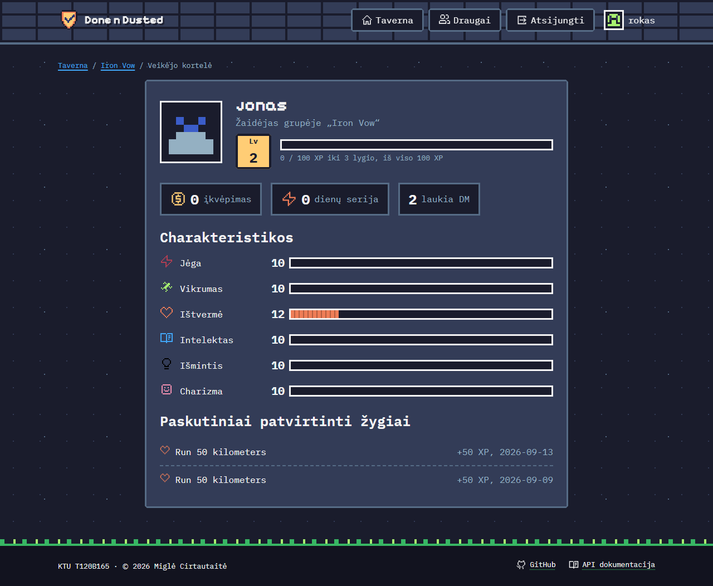
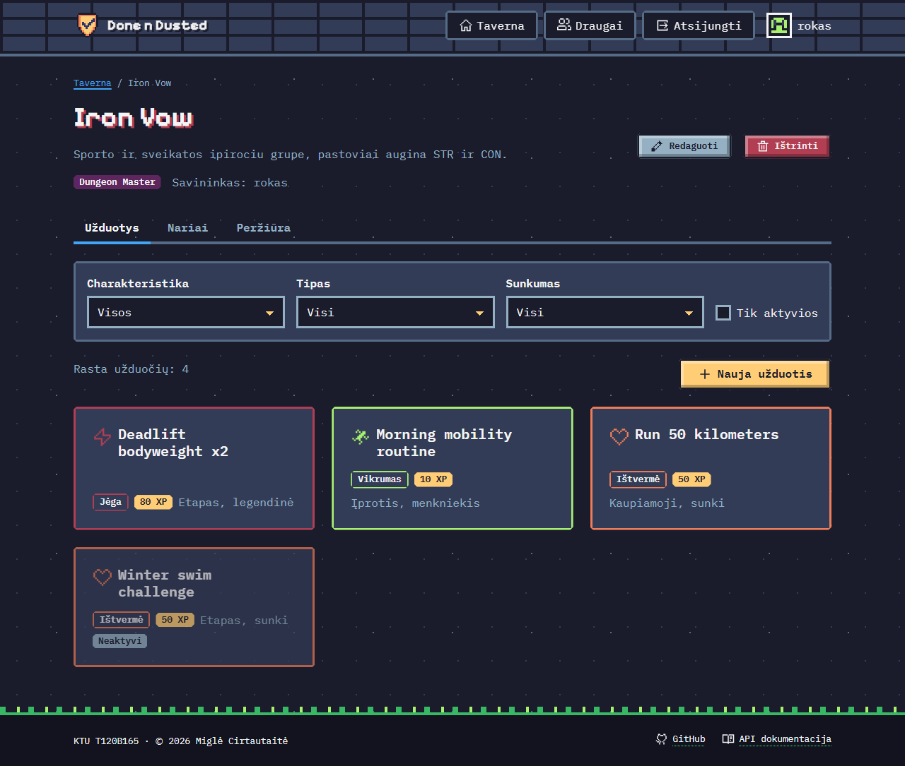
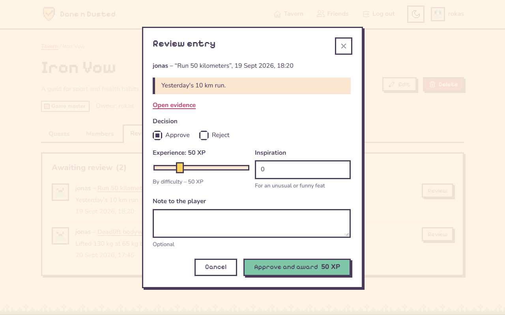
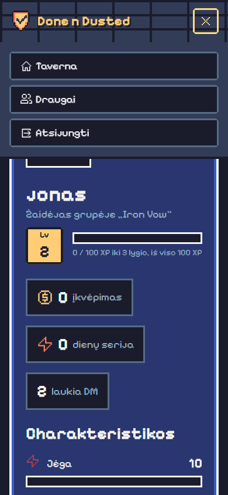
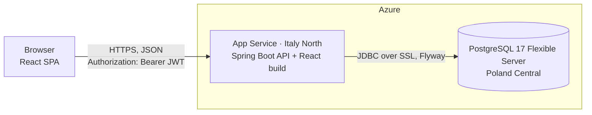

# Done n Dusted

[](https://github.com/cmigle/Done-n-Dusted/actions/workflows/ci.yml)

A pixel-art RPG productivity app for tabletop groups. Between game sessions, players log real-life
achievements (a run, a book, a call with a friend); the guild's game master reviews them, and only
approved entries grow the player's character — level, XP and six D&D stats.

Full-stack project: **Spring Boot 4 REST API** with JWT auth and role-based access, and a **React 19 +
TypeScript** client, built in three stages that are each kept on their own branch.

**Live demo: <https://done-n-dusted.azurewebsites.net>** · API docs: [Swagger UI](https://done-n-dusted.azurewebsites.net/swagger-ui.html) ·
demo accounts `rokas` (game master), `jonas` (player), `ieva` (password `Demo123!`); the admin password on the live demo is private



| Guild with quests | Game master review | Mobile |
| --- | --- | --- |
|  |  |  |

## Features

- **Guilds → quests → log entries** with strict parent-chain URLs (`/guilds/{id}/quests/{id}/logs/{id}`)
- **Roles per guild** (player, game master, owner) plus a global admin; one game master per guild, enforced in the database
- **Review flow**: entries start `PENDING`, the game master approves or rejects, XP is derived from difficulty and frozen on approval; nobody approves their own entry
- **Character sheet**: level, XP progress, six stats, inspiration and streak; full view for the player and game master, public view for others
- **Friendships**: requests, accept, block; friends see each other's public sheet across guilds
- **Auth**: short-lived JWT access tokens, rotating refresh tokens with reuse detection, BCrypt passwords
- **Pixel UI**: Sweetie-16 palette with a 60/30/10 rule and one colour per stat, Pixelify Sans headings with IBM Plex Mono text (readable numbers), SVG pixel icons, procedurally generated 8×8 avatars, responsive layout with a 768 px breakpoint and a hamburger menu

## Tech stack

| | |
| --- | --- |
| Backend | Java 21, Spring Boot 4.1 (Web MVC, Data JPA, Validation, Security 7 / OAuth2 Resource Server), Flyway, PostgreSQL 18 |
| API docs | OpenAPI 3.1 with springdoc (Swagger UI), Postman collection |
| Frontend | React 19, TypeScript, Vite, TanStack Query, React Router, pixelarticons |
| Tests | JUnit 5 + MockMvc on embedded PostgreSQL, Postman/newman, Vitest + Testing Library, Playwright |
| CI | GitHub Actions: backend tests, frontend lint/tests/build, API contract and end-to-end tests on every PR |
| Cloud | Azure App Service (Linux, Java 21) and Azure Database for PostgreSQL Flexible Server |

## Architecture



- One App Service serves both the API (`/api`) and the React build (`classpath:/static`): one URL, no CORS. Static Web Apps was not an option because the student subscription only allows regions where it is not offered.
- The API is stateless: each request carries a signed access token; group roles are read from the database on every request, so role changes apply immediately.
- Permission rules live in the service layer (`GuildAccess`), not in annotations, because they depend on data (author, game master, owner).
- Every error, including 401/403 from security filters, uses one `ApiError` JSON shape.
- The client keeps the access token in memory and serialises refreshes so concurrent `401`s never trigger refresh-token reuse detection.

## Run locally

Requirements: **Java 21** and **Node.js 22+**. No Docker or database install needed — the `dev` profile
starts an embedded PostgreSQL and seeds demo data.

```bash
./mvnw spring-boot:run              # API on http://localhost:8080, Swagger at /swagger-ui.html

cd frontend
npm install
npm run dev                         # UI on http://localhost:5173 (proxies /api to :8080)
```

Demo accounts (password `Demo123!`): `rokas` (game master), `ieva` (game master in another guild), `jonas` (player), `admin`.

## Tests

```bash
./mvnw test                                            # 42 backend integration and unit tests
npx newman run postman/DoneNDusted.postman_collection.json   # 78 requests, 176 assertions
cd frontend && npm test                                # 12 unit tests
cd frontend && npm run test:e2e                        # 10 Playwright scenarios (API and UI running)
```

## Deployment

`scripts/package.sh` builds the React app into `src/main/resources/static` and packages one jar; it runs on Azure App
Service with the `prod` profile. Configuration comes from environment variables (`DB_URL`, `DB_USER`, `DB_PASSWORD`,
`JWT_SECRET`, `CORS_ORIGINS`); details in [`docs/LD3.md`](docs/LD3.md#7-diegimas-į-debesį).

## Documentation

| | |
| --- | --- |
| [`docs/API.md`](docs/API.md) | Full API reference: auth, roles, every endpoint, error codes (Lithuanian) |
| [`docs/openapi.json`](docs/openapi.json) | OpenAPI 3.1 specification |
| [`docs/LD3.md`](docs/LD3.md) | UI requirements, wireframes, design system, tests (Lithuanian) |
| [`docs/LD2.md`](docs/LD2.md) | Authentication and authorization design notes (Lithuanian) |
| [`frontend/README.md`](frontend/README.md) | Frontend scripts and configuration |

## Project structure

```
src/main/java/lt/ktu/donendusted/   Spring Boot API: config, security, domain, repository, service, web, error
src/main/resources/db/migration/    Flyway migrations V1–V6 with seed data
src/test/java/                      MockMvc integration tests (embedded PostgreSQL)
frontend/                           React + TypeScript client, Vitest and Playwright tests
postman/                            Postman collection (v2.1 JSON and v3 YAML)
docs/                               API reference, lab notes, wireframes, screenshots
.github/workflows/                  CI pipeline
```

## Labs and versions

Each lab is kept on its own branch so it can still be checked out as submitted.

| Lab | Scope | Branch | Tag |
| --- | --- | --- | --- |
| LD1 | REST API: CRUD, nested resources, pagination with links, validation, error model | [`ld1`](https://github.com/cmigle/Done-n-Dusted/tree/ld1) | `v0.1.0` |
| LD2 | JWT authentication, refresh-token rotation, roles and per-guild permissions | [`ld2`](https://github.com/cmigle/Done-n-Dusted/tree/ld2) | `v0.2.1` |
| LD3 | React client, character sheet and friendships, tests, CI, cloud deployment | [`ld3`](https://github.com/cmigle/Done-n-Dusted/tree/ld3) | `v0.3.0` |

## Author

Miglė Cirtautaitė — Kaunas University of Technology, 2026.
