# Done n Dusted - user interface

The React client for the [REST API](API.md): a pixel-art RPG take on a quest log. Code is in
[`frontend/`](../frontend/); scripts and configuration are in [`frontend/README.md`](../frontend/README.md).

## Wireframes

The wireframes are generated by a script ([`wireframes/generate.mjs`](wireframes/generate.mjs)), so they
are easy to change and stay sharp (SVG).

| | |
| --- | --- |
| 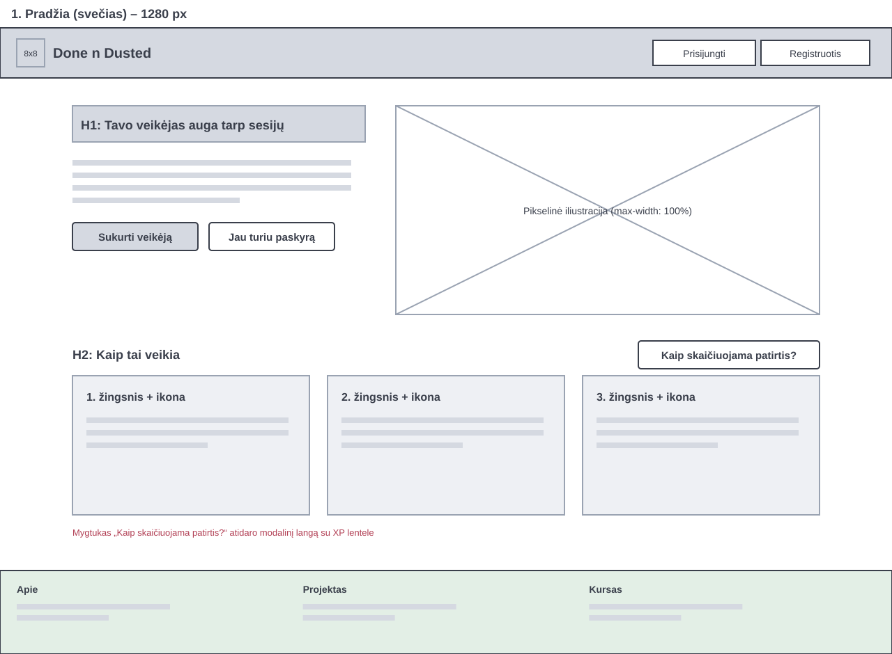 | 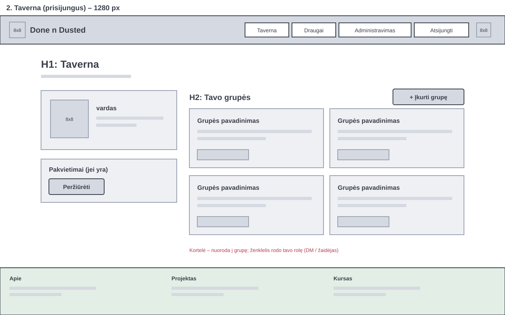 |
| 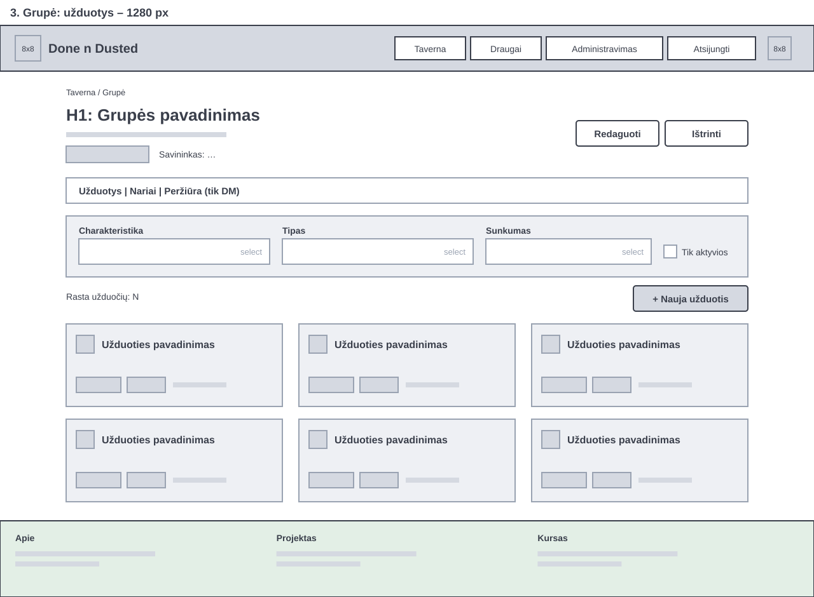 | 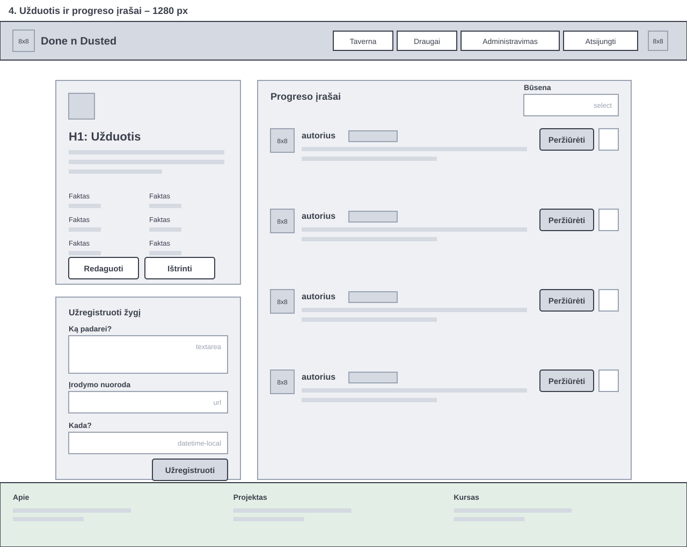 |
| 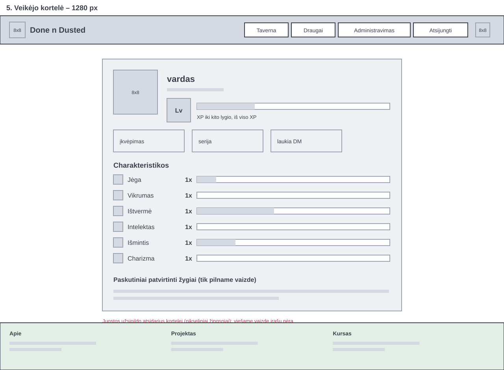 | 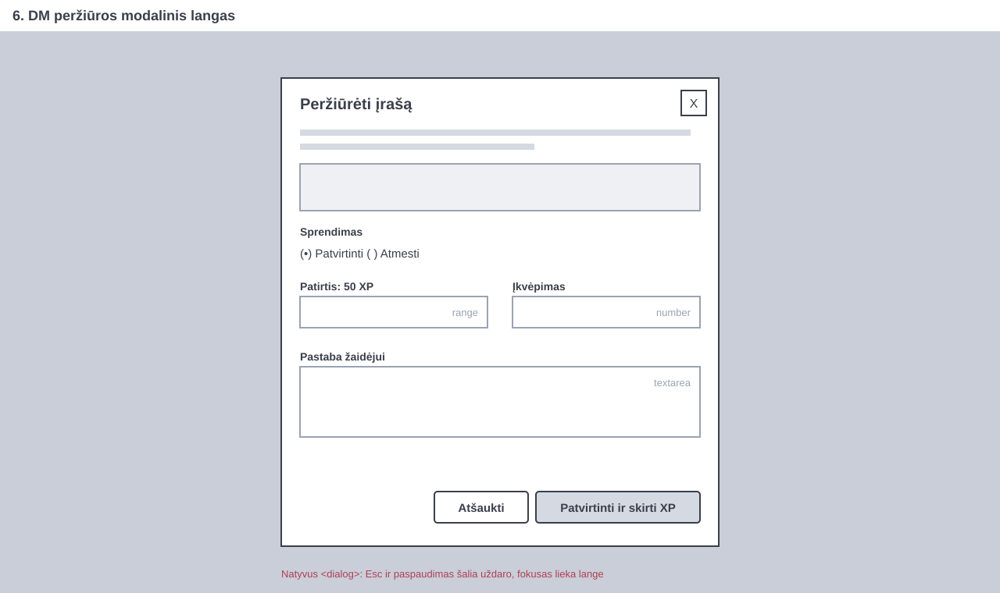 |


## Screenshots

| Desktop | Mobile |
| --- | --- |
| 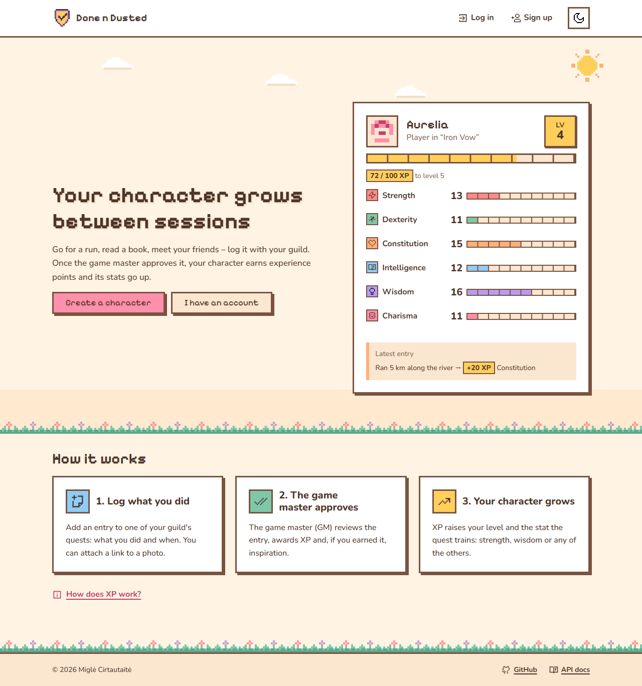 | 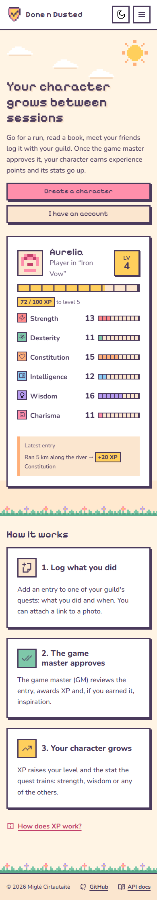 |
| 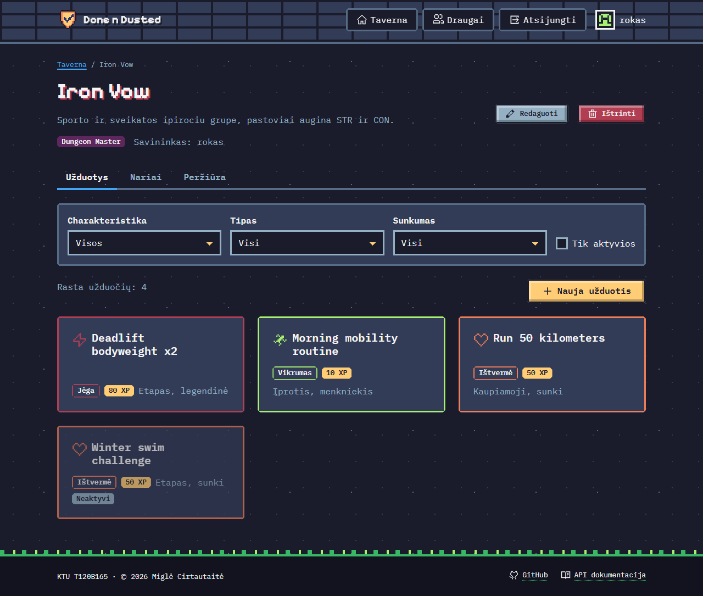 | 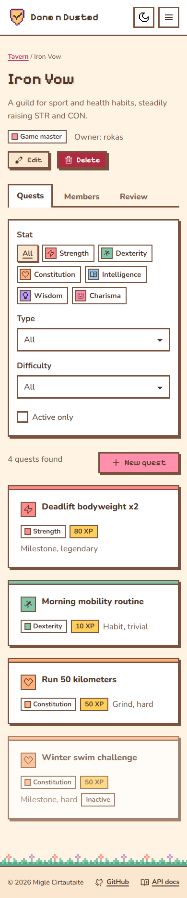 |
| 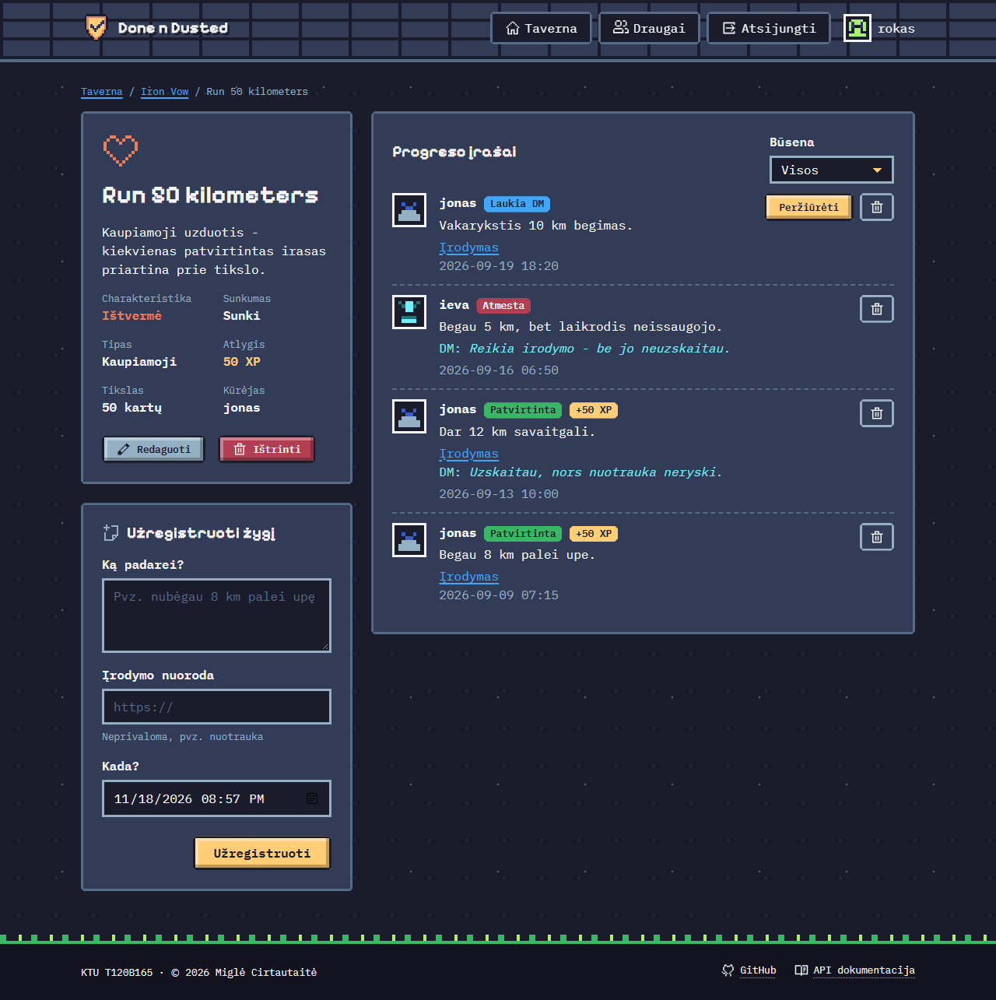 | 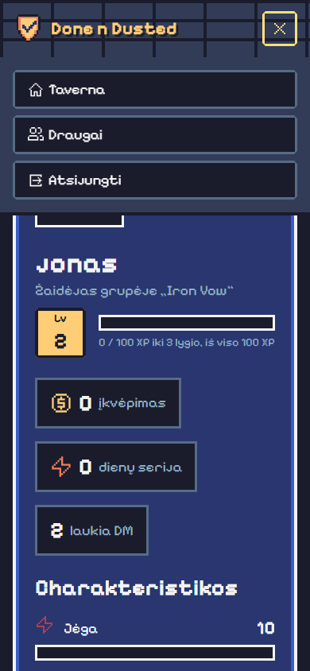 |

More in [`screenshots/`](screenshots/). The screenshots are taken automatically:
`npm run screenshots -- http://localhost:5173 ../docs/screenshots`.

## Architecture

```
frontend/src/
  api/          client.ts (fetch, tokens, refresh), endpoints.ts (every API method), types.ts
  auth/         AuthContext: signed-in user, login/logout, session restore
  components/   Layout (header, menu, footer), ui (Window, Modal, Bar, Field...), form modals
  pages/        Landing, Auth, Tavern, Guild, Quest, Sheet, Friends, AdminUsers, NotFound
  lib/          game.ts (names, colours, XP table), avatar.ts (pixel avatar)
  styles/       tokens, base, layout, components, pages
```

| Decision | Why |
| --- | --- |
| React 19 + TypeScript + Vite | Types mirror the API DTOs; Vite gives fast dev builds |
| TanStack Query | Caching and refetching after changes (`invalidateQueries`); 4xx errors are not retried |
| React Router | Meaningful paths (`/tavern`, `/guilds/:id`, `/guilds/:id/quests/:questId`); `RequireAuth` guards pages and `RequireAuth admin` guards administration |
| Access token in memory only | An XSS payload cannot read it from `localStorage`. The refresh token is in `localStorage` so a reload keeps the session |
| One refresh at a time | The server rotates refresh tokens and treats reuse as theft. If three requests got a `401` at once, three parallel refreshes would revoke every session, so they all wait on the same promise (`client.ts`, tested in `client.test.ts`) |
| Vite proxy in development | `/api` is forwarded to `localhost:8080`, so no CORS. A separately hosted API is set with `VITE_API_URL` plus backend CORS |
| Permissions in the UI | Buttons appear by role (game master, owner, admin), but the server decides; the UI only hides what the API would reject anyway |

## Design system

The theme is a tabletop RPG group that keeps a quest log between sessions. The visual language is
16-bit RPG menu windows.

| Token | Value |
| --- | --- |
| Palette | Sweetie-16 with a 60/30/10 rule: `midnight #1a1c2c` background (60%), `shadow #333c57` surfaces with a `slate` border (30%), `gold #ffcd75` only for primary actions, level and XP (10%) |
| Stat colours | The same across the whole site: STR `ruby`, DEX `lime`, CON `ember`, INT `sky`, WIS `aqua`, CHA pink `#f08fb0` (`--stat-*` tokens) |
| Fonts | Pixelify Sans (H1, H2, logo) and IBM Plex Mono (everything else), 1.25 scale, 16 px base; H1 on mobile ~32 px with `text-wrap: balance` |
| Grid | 8 px step, 1120 px container, breakpoints at 768 and 1024 px |
| "Pixel" look | 4 px borders, cut corners (`clip-path`), shadows without blur |
| Motion | `steps()` animation like old games; the only automatic motion is the character sheet bars |

The signature element is a **procedurally generated pixel avatar**: the username is hashed to a number
that gives a symmetric 8×8 figure and two colours. The same name always gives the same avatar, so no
images are stored (`lib/avatar.ts`, tested in `avatar.test.ts`).

The logo and illustration are generated by a script from ASCII drawings and shapes: `npm run pixel-art`.

## Testing

| Level | What | Count | Command |
| --- | --- | --- | --- |
| Backend integration | MockMvc + embedded PostgreSQL: auth, permissions, validation, character sheet, friendships, UI routes | 48 | `./mvnw test` |
| API contract | Postman collection | 78 requests, 176 checks | `npx newman run postman/DoneNDusted.postman_collection.json` |
| Frontend unit | Vitest + Testing Library: API client (concurrent refresh), avatar, components, forms | 12 | `npm test` |
| End-to-end | Playwright: guest, login, log entry → game master approval → character sheet, quest form, `409` on a field, friend's sheet, administration, mobile menu, 404 | 10 | `npm run test:e2e` |

Everything runs on every pull request in [GitHub Actions](../.github/workflows/ci.yml). The end-to-end
tests caught a real bug: after logging out and in as another user, the app returned to the previous
user's page (fixed in `AuthContext` with `signedOut`).

Deployment to Azure is described in [`DEPLOYMENT.md`](DEPLOYMENT.md).
