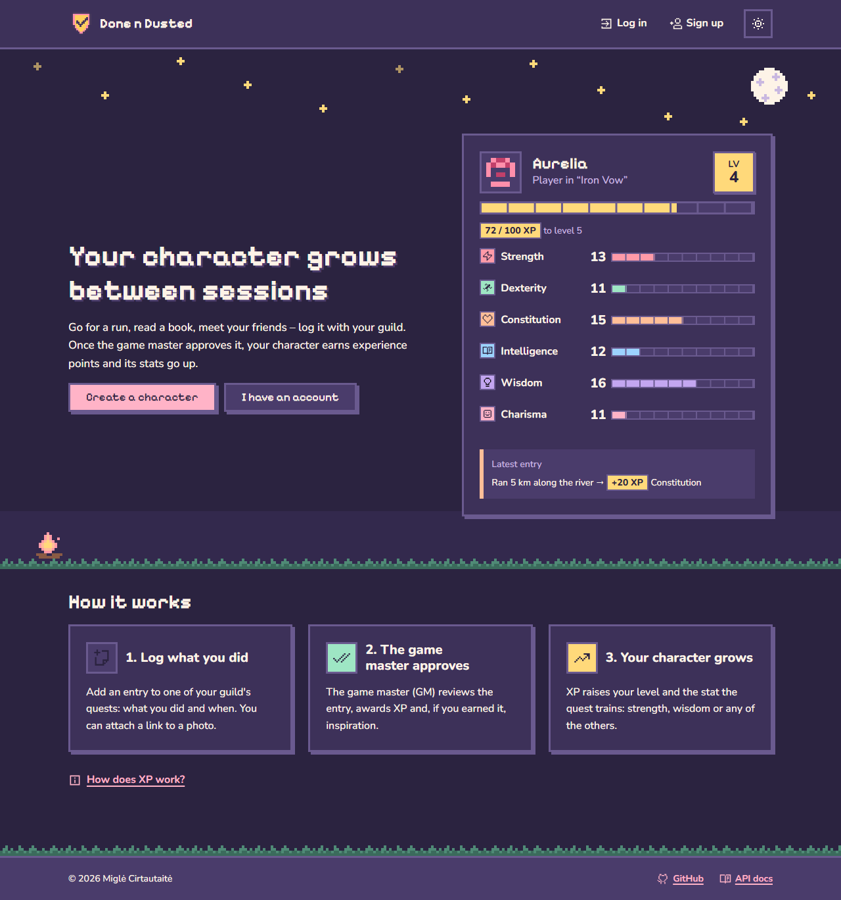
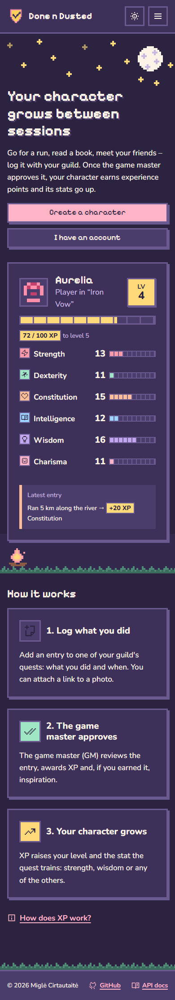

# Done n Dusted - user interface

The React client for the [REST API](API.md): a pixel-art RPG take on a quest log. Code is in
[`frontend/`](../frontend/); scripts and configuration are in [`frontend/README.md`](../frontend/README.md).

## Wireframes

The wireframes are generated by a script ([`wireframes/generate.mjs`](wireframes/generate.mjs)), so they
are easy to change and stay sharp (SVG).

| | |
| --- | --- |
|  |  |
|  |  |
|  |  |


## Screenshots

| Desktop | Mobile |
| --- | --- |
|  |  |
|  |  |
|  |  |
|  |  |
|  | |

More in [`screenshots/`](screenshots/). The screenshots are taken automatically:
`npm run screenshots -- http://localhost:5173 ../docs/screenshots`.

## Architecture

```
frontend/src/
  api/          client.ts (fetch, tokens, refresh), endpoints.ts (every API method), types.ts
  auth/         AuthContext: signed-in user, login/logout, session restore
  components/   Layout (header, menu, footer), ui (Window, Modal, Bar, Field...), form modals,
                Scene (day and night pixel scene), ThemeToggle, StatIcon
  pages/        Landing, Auth, Tavern, Guild, Quest, Sheet, Friends, AdminUsers, NotFound
  lib/          game.ts (names, colours, XP table), avatar.ts (pixel avatar), theme.ts (day/night)
  styles/       tokens, base, layout, components, pages, scene
```

| Decision | Why |
| --- | --- |
| React 19 + TypeScript + Vite | Types mirror the API DTOs; Vite gives fast dev builds |
| TanStack Query | Caching and refetching after changes (`invalidateQueries`); 4xx errors are not retried |
| React Router | Meaningful paths (`/tavern`, `/guilds/:id`, `/guilds/:id/quests/:questId`); `RequireAuth` guards pages and `RequireAuth admin` guards administration |
| Access token in memory only | An XSS payload cannot read it from `localStorage`. The refresh token is in `localStorage` so a reload keeps the session |
| One refresh at a time | The server rotates refresh tokens and treats reuse as theft. If three requests got a `401` at once, three parallel refreshes would revoke every session, so they all wait on the same promise (`client.ts`, tested in `client.test.ts`) |
| Vite proxy in development | `/api` is forwarded to `localhost:8080`, so no CORS. A separately hosted API is set with `VITE_API_URL` plus backend CORS |
| Permissions in the UI | Buttons appear by role (game master, owner, admin), but the server decides; the UI only hides what the API would reject anyway |

## Design system

The theme is a tabletop RPG group that keeps a quest log between meetups. The visual language is
cute pixel-art RPG, in two themes: a light "day" and a dark "night".

**How the theme works.** By default the theme follows the system (`prefers-color-scheme`). The header
button (sun / moon, `aria-label="Toggle theme"`) sets `<html data-theme="light|dark">` and saves the
choice in `localStorage` (inside `try/catch`, so with storage blocked the theme lasts until reload).
A small script in the `<head>` of `index.html` applies the saved theme before first paint, so a reload
never flashes the other theme; it also updates `<meta name="theme-color">`. An end-to-end test checks
this by reading `data-theme` at the moment `<body>` is created.

| Token | Value |
| --- | --- |
| Surfaces | Day: background `#fff4e4`, cards `#ffffff`, `surface-2 #fbe6cf`. Night: `#2b2340`, `#3d3159`, `#4a3c6b`. Text and ink `#4a3a5c` (day) / `#fdf3e7` (night); no pure black |
| Accents | `--primary` (pink) only for the one main action on a screen; `--xp` (yellow) only for XP and level; `--success` / `--danger` for approve and delete |
| Stat colours | The same across the whole site: STR, DEX, CON, INT, WIS and CHA each have a `--stat-*` token in both themes (bars, icon tiles, filters, the stripe on quest cards) |
| Pastels and text | A pastel is never a text colour: text on a pastel is dark ink (icon tiles, XP chip), and in badges the colour is only a square next to the text |
| Fonts | Pixelify Sans (logo, H1, H2, buttons) and Nunito (everything else, numbers with `tabular-nums`); on mobile 17 px text, 1.6 line height, H1 ~32 px with `text-wrap: balance` |
| Grid | 8 px step, 1120 px container, breakpoints at 768 and 1024 px |
| "Pixel" look | 3 px `--ink` border and a `4px 4px 0 var(--ink)` shadow; a button moves 2 px on hover (2 px shadow) and 4 px when pressed (no shadow) |
| Motion | `steps()` animation like old games; in the scene, drifting clouds, twinkling stars and a campfire. All of it stops under `prefers-reduced-motion` |
| Scene | Inline SVG drawn from text grids (one character is one 4 px pixel), coloured from CSS variables: day has a sun, clouds and grass with flowers; night has a moon, twinkling stars and a campfire (`components/Scene.tsx`) |

The pixel font makes 5 and S, 8 and B, 0 and O look alike, so numbers are set in Nunito even inside
buttons (`.digits`).

The signature element is a **procedurally generated pixel avatar**: the username is hashed to a number
that gives a symmetric 8×8 figure and two colours. The same name always gives the same avatar, so no
images are stored (`lib/avatar.ts`, tested in `avatar.test.ts`).

The logo is generated by a script from an ASCII drawing: `npm run pixel-art`.

### Contrast

Computed per WCAG 2.x from the values in `styles/tokens.css` by `npm run contrast`, which also runs in
CI. The script also checks that the "system is dark" block matches `[data-theme='dark']`.

| Pair | Used for | Light | Dark | Min |
| --- | --- | --- | --- | --- |
| `--text` on `--bg` | body text on the page | 9.42 ✓ | 13.51 ✓ | 4.5 |
| `--text` on `--surface` | text in cards, forms, modals | 10.24 ✓ | 10.75 ✓ | 4.5 |
| `--text` on `--surface-2` | footer, quotes, counters, tables | 8.45 ✓ | 8.91 ✓ | 4.5 |
| `--text-muted` on `--bg` | hints and meta on the page | 5.35 ✓ | 8.06 ✓ | 4.5 |
| `--text-muted` on `--surface` | hints and meta in cards | 5.82 ✓ | 6.41 ✓ | 4.5 |
| `--text-muted` on `--surface-2` | meta in the footer and counters | 4.80 ✓ | 5.31 ✓ | 4.5 |
| `--link` on `--bg` | links on the page | 4.56 ✓ | 8.84 ✓ | 4.5 |
| `--link` on `--surface` | links in cards | 4.96 ✓ | 7.03 ✓ | 4.5 |
| `--link-2` on `--surface-2` | footer links | 8.45 ✓ | 5.83 ✓ | 4.5 |
| `--danger-ink` on `--surface` | form errors | 6.45 ✓ | 6.83 ✓ | 4.5 |
| `--danger-ink` on `--bg` | errors on the page, 404 | 5.93 ✓ | 8.59 ✓ | 4.5 |
| `--on-primary` on `--primary` | main CTA button | 4.76 ✓ | 8.84 ✓ | 4.5 |
| `--on-primary` on `--xp` | XP chips, level badge | 6.99 ✓ | 10.91 ✓ | 4.5 |
| `--on-primary` on `--success` | Approve / Accept buttons | 5.23 ✓ | 10.28 ✓ | 4.5 |
| `--on-danger` on `--danger-btn` | Delete / Reject buttons | 6.45 ✓ | 7.37 ✓ | 4.5 |
| `--text` on `--surface-2` | secondary buttons | 8.45 ✓ | 8.91 ✓ | 4.5 |
| `--on-primary` on `--stat-str` | STR icon tile | 4.51 ✓ | 7.37 ✓ | 3 |
| `--on-primary` on `--stat-dex` | DEX icon tile | 5.23 ✓ | 10.28 ✓ | 3 |
| `--on-primary` on `--stat-con` | CON icon tile | 5.73 ✓ | 9.22 ✓ | 3 |
| `--on-primary` on `--stat-int` | INT icon tile | 5.95 ✓ | 9.30 ✓ | 3 |
| `--on-primary` on `--stat-wis` | WIS icon tile | 4.40 ✓ | 7.08 ✓ | 3 |
| `--on-primary` on `--stat-cha` | CHA icon tile | 4.76 ✓ | 8.84 ✓ | 3 |
| `--focus` on `--bg` | focus outline on the page (non-text) | 4.56 ✓ | 10.91 ✓ | 3 |
| `--focus` on `--surface` | focus outline in cards (non-text) | 4.96 ✓ | 8.67 ✓ | 3 |
| `--control` on `--surface` | form control borders in cards (non-text) | 10.24 ✓ | 6.41 ✓ | 3 |
| `--control` on `--bg` | form control borders on the page (non-text) | 9.42 ✓ | 8.06 ✓ | 3 |

## Testing

| Level | What | Count | Command |
| --- | --- | --- | --- |
| Backend integration | MockMvc + embedded PostgreSQL: auth, permissions, validation, character sheet, friendships, UI routes | 48 | `./mvnw test` |
| API contract | Postman collection | 78 requests, 176 checks | `npx newman run postman/DoneNDusted.postman_collection.json` |
| Frontend unit | Vitest + Testing Library: API client (concurrent refresh), avatar, components, forms | 14 | `npm test` |
| End-to-end | Playwright: guest, login, log entry → game master approval → character sheet, quest form, `409` on a field, friend's sheet, administration, theme saved with no flash on reload, mobile menu, 404 | 11 | `npm run test:e2e` |
| Contrast | Every text and control colour pair in both themes against WCAG | 26 pairs | `npm run contrast` |

Everything runs on every pull request in [GitHub Actions](../.github/workflows/ci.yml). The end-to-end
tests caught a real bug: after logging out and in as another user, the app returned to the previous
user's page (fixed in `AuthContext` with `signedOut`).

Deployment to Azure is described in [`DEPLOYMENT.md`](DEPLOYMENT.md).
