# LD3 — naudotojo sąsaja ir diegimas

React klientas LD1–LD2 REST API, pikselinio RPG stiliaus. Kodas — [`frontend/`](../frontend/),
API aprašas — [`API.md`](API.md). Šaka `ld3`, žyma `v0.3.0`.

Sąsaja – anglų kalba, kad projektą suprastų ir tarptautinė auditorija; šie aprašai – lietuviškai.


---

## 1. Reikalavimai ir jų įgyvendinimas

| Reikalavimas | Kaip įgyvendinta | Kur žiūrėti |
| --- | --- | --- |
| Sąsajos projektas (wireframe'ai) | 7 langų wireframe'ai: pradžia, taverna, grupė, užduotis, kortelė, DM modalinis langas, telefonas | [2 skyrius](#2-wireframeai), [`wireframes/`](wireframes/) |
| Sąsaja REST API | 31 iš 35 API metodų: grupės, užduotys, įrašai, nariai, kortelė, draugai, naudotojai, autentifikacija. Nenaudojami tik 4 pavieniai `GET` pagal ID (įrašas, narys, naudotojas, draugystė) — tie duomenys jau ateina sąraše | `frontend/src/api/endpoints.ts` |
| Responsive, bent 1 breakpoint | Pagrindinis lūžis **768 px** (meniu, tinklelis, formos, sąrašai); papildomai 1024 px (3 stulpelių kortelės) | `styles/layout.css`, `styles/pages.css` |
| Paveikslėlių prisitaikymas | `img, svg { max-width: 100%; height: auto }`; iliustracija ir avatarai mažėja kartu su konteineriu | `styles/base.css`, [ekrano nuotraukos](#3-ekrano-nuotraukos) |
| Header, Content, Footer — skirtingi stiliai | Header — `surface` juosta su rašalo apačia, pikselinis logotipas, temos jungiklis; Content — kortelės su rašalo rėmeliu ir kietu 4 px šešėliu, pradžioje — dangaus scena; Footer — `surface-2` juosta su pikselinės žolės kraštu viršuje | `styles/layout.css`, `styles/components.css` |
| Analogiški elementai skirtingose srityse atrodo skirtingai | Nuorodos: header'yje — skirtukai su rėmeliu, turinyje — rožinės (`--link`) pabrauktos, footer'yje — teksto spalvos su ikona. Antraštės: header'yje — logotipas, turinyje — pikselinės su šešėliu, kortelėse — Nunito | tie patys |
| Įvedimo sąsaja, keli input tipai | `text`, `password`, `textarea`, `select`, `radio`, `checkbox`, `number`, `url`, `datetime-local`, `range`, `search` | `QuestFormModal`, `ReviewModal`, `QuestPage` (žygio forma), `AuthPages`, `AdminUsersPage` |
| Transitions / animacijos | XP ir savybių juostos užsipildo pikseliniais žingsniais; modalinis langas „iššoka“; pranešimai įslysta; mygtukai ir kortelės „nusispaudžia“ į savo šešėlį; meniu išsiskleidžia; temos keitimas — 200 ms spalvų perėjimas; scenoje plaukia debesys, mirksi žvaigždės, laužo liepsna — 3 kadrai. `prefers-reduced-motion` — viskas sustoja | `styles/components.css` |
| Responsive meniu (desktop — horizontalus, mobile — hamburger) | ≥ 768 px — horizontalūs skirtukai; < 768 px — hamburger mygtukas su `aria-expanded`, meniu išsiskleidžia po header'iu ir užsidaro pasirinkus punktą | `components/Layout.tsx`, `styles/layout.css` |
| Vektorinės ikonos | [pixelarticons](https://pixelarticons.com) (SVG, MIT) per `@nsmr/pixelart-react`; logotipas, scena (saulė, mėnulis, debesys, žolė, laužas) ir avatarai — taip pat SVG | `components/StatIcon.tsx`, `public/*.svg` |
| Kitoks šriftas | Google Fonts (su `latin-ext`): **Pixelify Sans** — logotipui, H1, H2 ir mygtukams; **Nunito** — tekstui, formoms, lentelėms ir skaičiams (`tabular-nums`). Pikseliniame šrifte 5 ↔ S, 8 ↔ B, 0 ↔ O panašūs, todėl skaičiai net mygtukuose rašomi Nunito (`.digits`) | `index.html`, `styles/tokens.css` |
| Modalinis langas su prasminga informacija | „How XP works“ (XP lentelė ir formulės), žaidimo vedėjo įrašo peržiūra, užduoties ir grupės formos, draugo kortelė, trynimo patvirtinimas. Natūralus `<dialog>`: fokusas lange, `Esc` ir paspaudimas šalia uždaro | `components/ui.tsx` (`Modal`), `XpRulesModal.tsx`, `ReviewModal.tsx` |
| Derančios spalvos | Dvi pastelinės temos — šviesi „diena“ ir tamsi „naktis“ — iš tų pačių žetonų; kiekviena savybė turi savo spalvą (juostos, ikonų plytelės, filtrai, užduočių kortelės) | `styles/tokens.css` |
| Išdėstymas pagal tinklelį | 12 kolonų logika per CSS Grid (`grid--2`, `grid--3`, `grid--sidebar` 4/8), visi tarpai — 8 px kartotiniai, konteineris 1120 px | `styles/layout.css` |
| Matomumas ir pasiekiamumas | Kontrastas tikrinamas skriptu abiem temomis (tekstas ≥ 4,5:1, rėmeliai ≥ 3:1, [lentelė](#kontrastas)), matomas fokusas (3 px `--focus`), „Pereiti prie turinio“ nuoroda, `aria-*` progreso juostoms, skirtukams ir meniu, etiketės visiems laukams, klaidos susietos su laukais | `styles/base.css`, `components/ui.tsx` |
| Aiškios ir nuoseklios formos | Visur ta pati struktūra: etiketė → laukas → užuomina → klaida; serverio klaidos rodomos prie konkretaus lauko; veiksmo mygtukas sako, kas įvyks („Approve and award 50 XP“) | `components/ui.tsx` (`Field`) |
| Vientisas dizainas | Vieni žetonai abiem temoms, dvi šriftų rolės, vienas „pikselio“ vienetas: 3 px rašalo rėmelis ir 4 px kietas šešėlis visose kortelėse ir mygtukuose | [5 skyrius](#5-dizaino-sistema) |
| Pasiekiama saityne (debesys) | Azure App Service + Azure Database for PostgreSQL: <https://done-n-dusted.azurewebsites.net> | [7 skyrius](#7-diegimas-į-debesį) |
| Kodas Git, dokumentacija | GitHub, šakos `ld1`/`ld2`/`ld3`, PR istorija, šis dokumentas ir [`README.md`](../README.md) | |

---

## 2. Wireframe'ai

Wireframe'ai sugeneruoti skriptu ([`wireframes/generate.mjs`](wireframes/generate.mjs)), todėl juos
lengva pakeisti ir jie visada ryškūs (SVG).

| | |
| --- | --- |
| 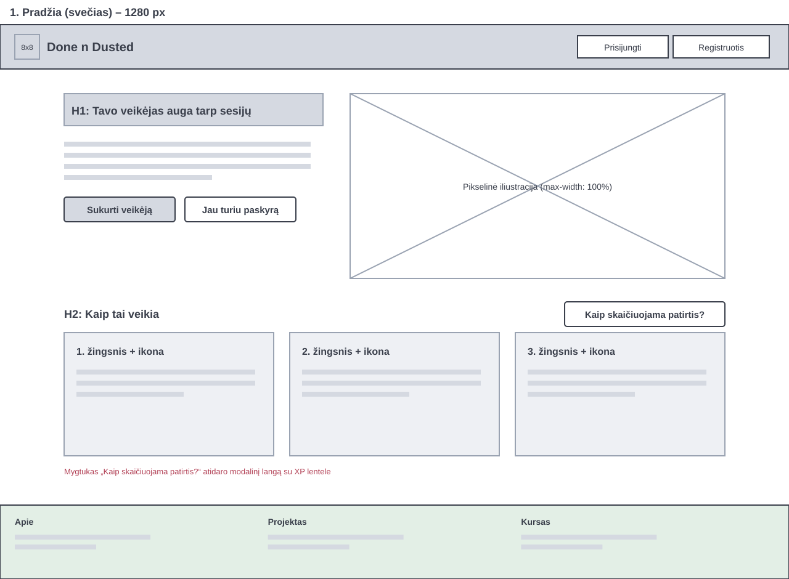 | 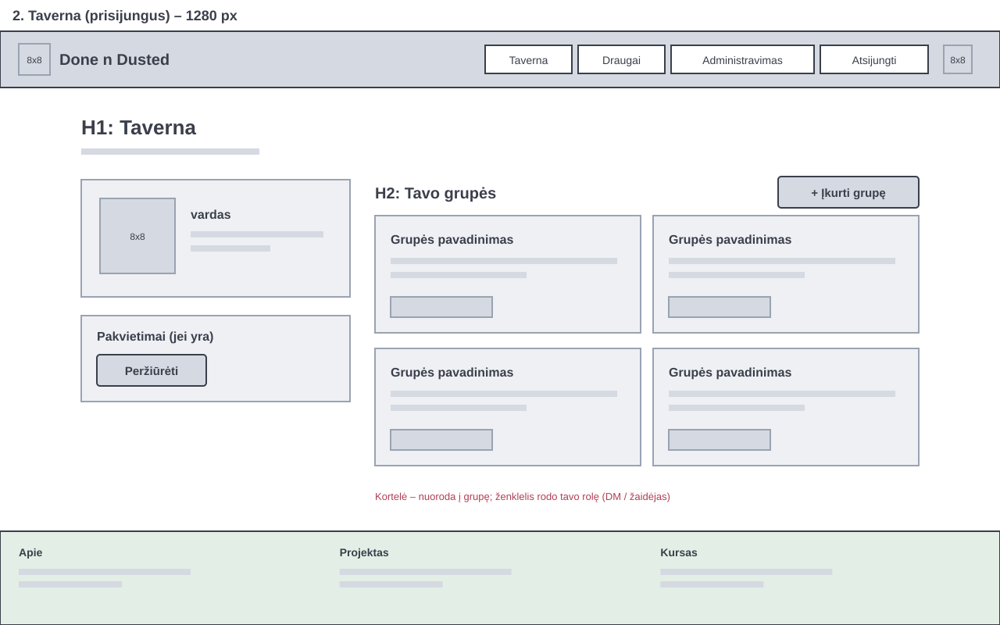 |
| 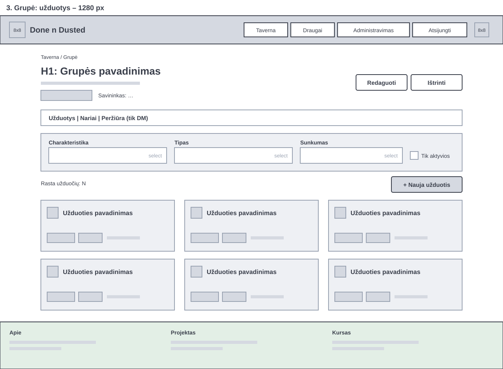 | 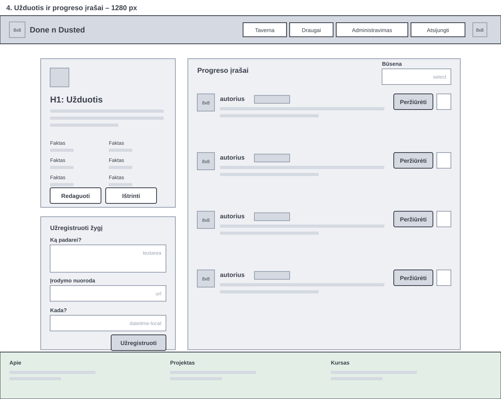 |
| 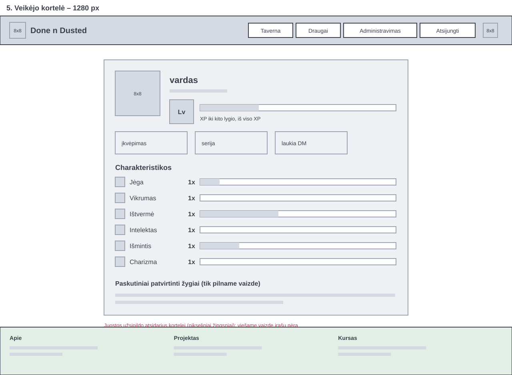 | 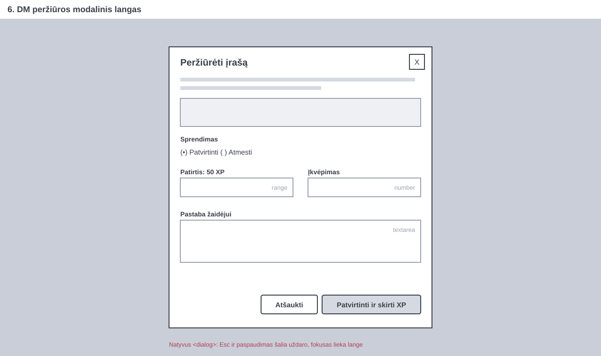 |


---

## 3. Ekrano nuotraukos

| Kompiuteris | Telefonas |
| --- | --- |
|  |  |
| 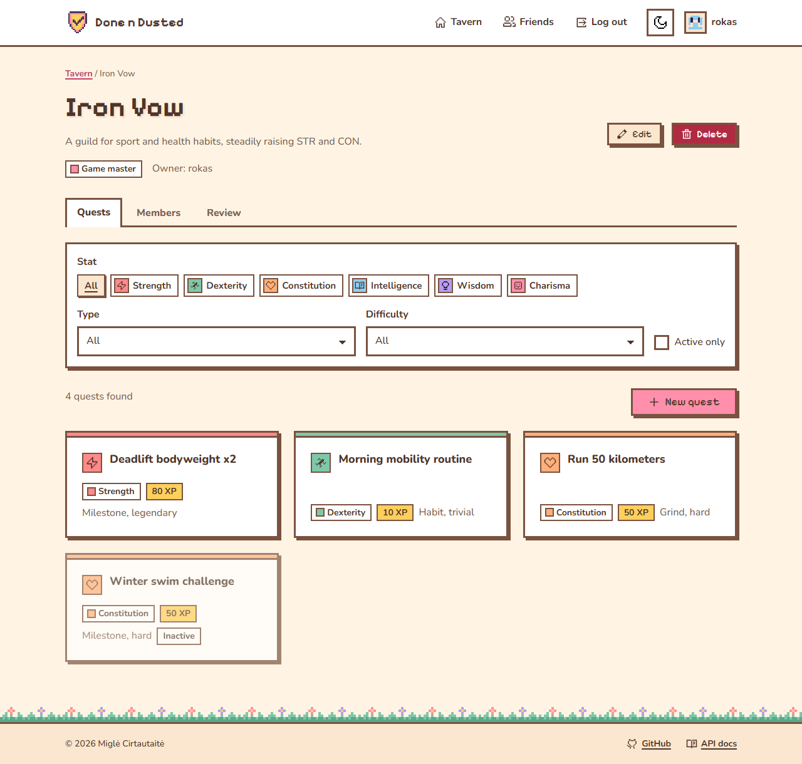 |  |
| 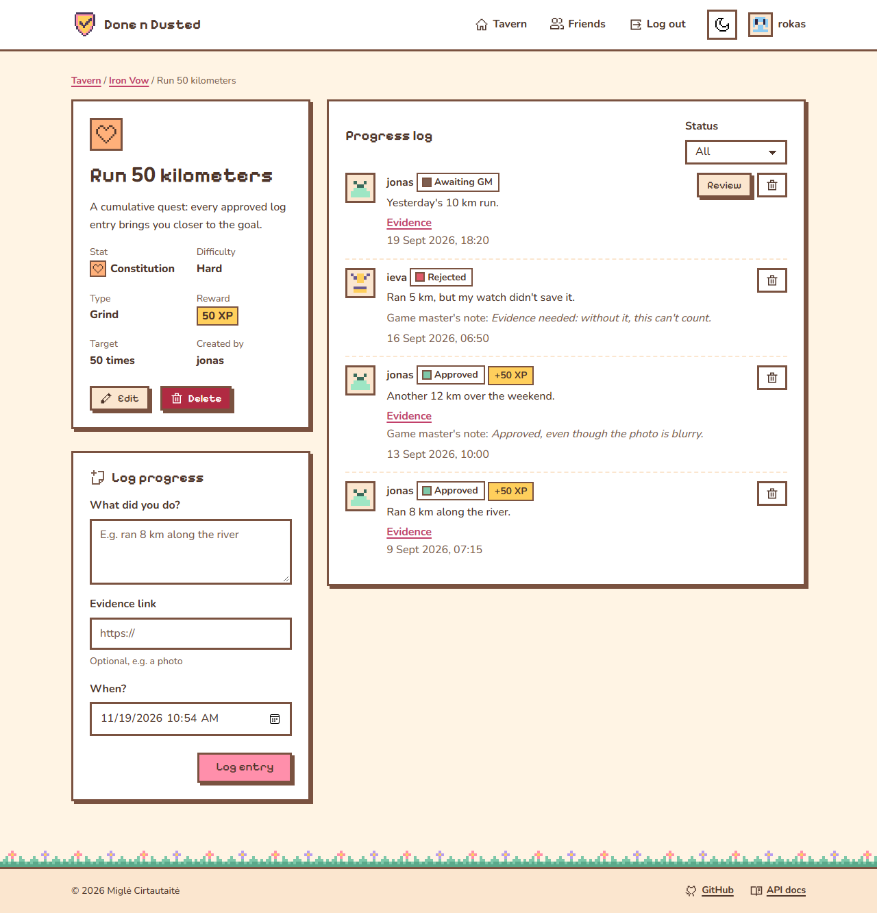 | 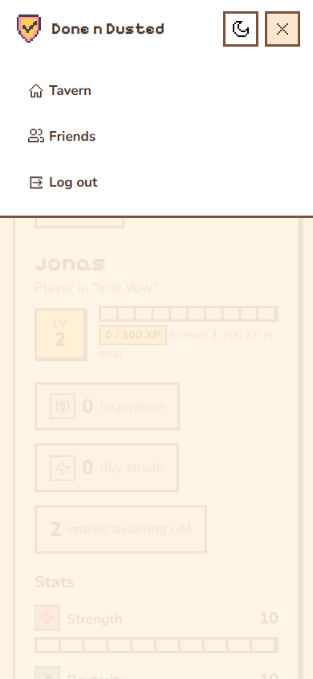 |
| 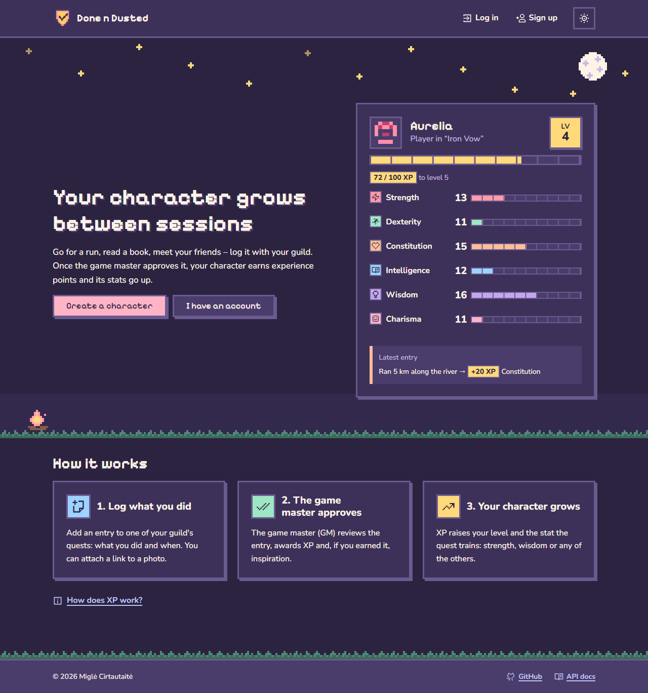 | 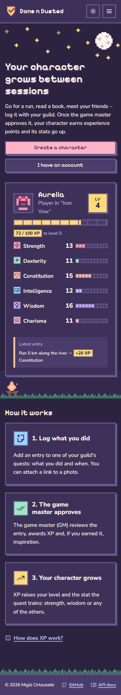 |
| 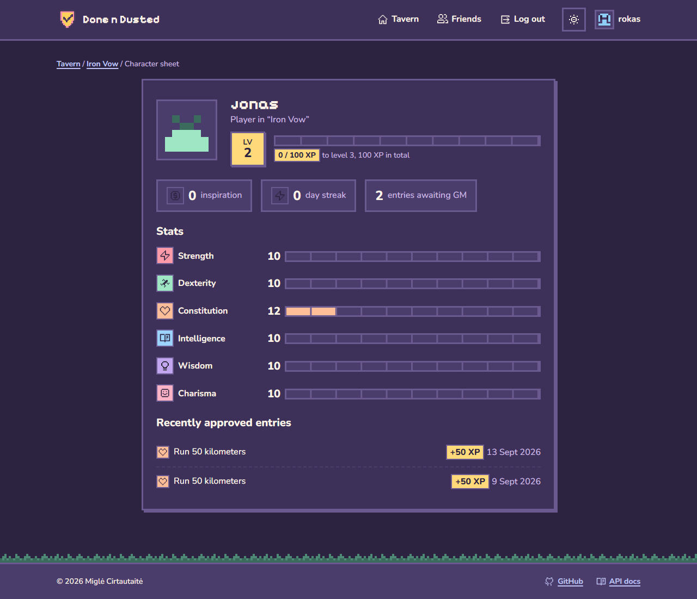 | |

Daugiau — [`screenshots/`](screenshots/). Nuotraukos padarytos automatiškai:
`npm run screenshots -- http://localhost:5173 ../docs/screenshots`.

---

## 4. Sąsajos architektūra

```
frontend/src/
  api/          client.ts (fetch, žetonai, refresh), endpoints.ts (visi API metodai), types.ts
  auth/         AuthContext - prisijungęs naudotojas, login/logout, sesijos atkūrimas
  components/   Layout (header, meniu, footer), ui (Window, Modal, Bar, Field...), formų modaliniai langai
  pages/        Landing, Auth, Tavern, Guild, Quest, Sheet, Friends, AdminUsers, NotFound
  lib/          game.ts (pavadinimai, spalvos, XP lentelė), avatar.ts (pikselinis avataras)
  styles/       tokens, base, layout, components, pages
```

| Sprendimas | Kodėl |
| --- | --- |
| React 19 + TypeScript + Vite | Tipai sutampa su API DTO; Vite — greitas kūrimas ir build |
| TanStack Query | Kešavimas ir pakartotinis užkrovimas po pakeitimų (`invalidateQueries`); 4xx klaidos nekartojamos |
| React Router | Prasmingi keliai (`/tavern`, `/guilds/:id`, `/guilds/:id/quests/:questId`), `RequireAuth` apsaugo puslapius, `RequireAuth admin` — administravimą |
| Access žetonas tik atmintyje | XSS negali jo perskaityti iš `localStorage`. Refresh — `localStorage`, kad sesija išliktų perkrovus |
| Vienas refresh vienu metu | Serveris rotuoja refresh žetoną ir pakartotinį panaudojimą laiko vagyste. Jei 3 užklausos vienu metu gautų `401`, trys lygiagretūs `refresh` atšauktų visas sesijas — todėl jie laukia to paties pažado (`client.ts`, testas `client.test.ts`) |
| Vystant — Vite proxy | `/api` nukreipiamas į `localhost:8080`, CORS nereikia. Debesyje — `VITE_API_URL` ir backend CORS |
| Teisės sąsajoje | Mygtukai rodomi pagal rolę (DM, savininkas, ADMIN), bet sprendžia serveris — sąsaja tik nerodo to, ko vis tiek neleistų |

---

## 5. Dizaino sistema

Tema — stalo RPG grupė, kuri tarp susitikimų pildo savo žygių žurnalą. Vaizdinė kalba — miela
pikselinė RPG: dvi temos, šviesi „diena“ ir tamsi „naktis“.

**Temos mechanizmas.** Pagal nutylėjimą tema seka sistemą (`prefers-color-scheme`). Header'io mygtukas
(saulė / mėnulis, `aria-label="Toggle theme"`) nustato `<html data-theme="light|dark">` ir įrašo
pasirinkimą į `localStorage` (`try/catch` — kai saugykla užblokuota, tema galioja iki perkrovimo).
Mažas skriptas `index.html` `<head>` pritaiko išsaugotą temą dar prieš pirmą piešimą, todėl
perkrovus nemirkteli kita tema; jis atnaujina ir `<meta name="theme-color">`. Tai tikrina E2E testas:
užfiksuoja `data-theme` tą akimirką, kai sukuriamas `<body>`.

| Žetonas | Reikšmė |
| --- | --- |
| Paviršiai | Diena: fonas `#fff4e4`, kortelės `#ffffff`, `surface-2 #fbe6cf`. Naktis: `#2b2340`, `#3d3159`, `#4a3c6b`. Dieną tekstas šokoladinis `#4e352a`, rėmeliai ir šešėliai kakavos `#7a5240`; naktį tekstas `#fdf3e7`; juodos (#000) nėra |
| Akcentai | `--primary` (rožinė) — tik vienam pagrindiniam veiksmui ekrane; `--xp` (geltona) — tik XP ir lygiui; `--success` / `--danger` — patvirtinimas ir trynimas; `--info` (dangaus mėlyna) — informacinės plytelės; naktį nuorodos ramios levandinės `#bfc3f5`, kad nekonkuruotų su rožiniu veiksmo mygtuku |
| Savybių spalvos | Visame saite tos pačios: STR, DEX, CON, INT, WIS, CHA turi savo `--stat-*` žetoną abiem temoms (juostos, plytelės, filtrai, užduočių kortelių juosta) |
| Pastelės ir tekstas | Pastelinė spalva niekada nėra teksto spalva: ant jos — tamsus rašalas (ikonų plytelės, XP ženklelis), o ženkleliuose spalva — tik kvadratėlis šalia teksto |
| Šriftai | Pixelify Sans (logotipas, H1, H2, mygtukai) ir Nunito (visa kita, skaičiai — `tabular-nums`); telefone tekstas 17 px, eilutės aukštis 1,6, H1 ~32 px su `text-wrap: balance` |
| Tinklelis | 8 px žingsnis, konteineris 1120 px, lūžiai 768 ir 1024 px |
| „Pikselis“ | 3 px `--ink` rėmelis ir `4px 4px 0 var(--ink)` šešėlis; mygtukas užvedus pasislenka 2 px (šešėlis 2 px), paspaudus — 4 px (šešėlio nebelieka) |
| Judesys | `steps()` laiptinė animacija — kaip senuose žaidimuose; scena: debesys, žvaigždės, laužas |
| Scena | Inline SVG iš teksto tinklelių (vienas simbolis — 4 px pikselis), spalvos iš CSS kintamųjų: diena — saulė, debesys, žolė su gėlėmis; naktis — mėnulis, mirksinčios žvaigždės, laužas (`components/Scene.tsx`) |

Įsimintinas elementas — **procedūriškai generuojamas pikselinis avataras**: iš vardo gaunamas
skaičius, iš jo — simetriška 8×8 figūra ir dvi spalvos. Tas pats vardas visada duoda tą patį
avatarą, paveikslėlių saugoti nereikia (`lib/avatar.ts`, testas `avatar.test.ts`).

Logotipas generuojamas skriptu iš ASCII piešinio: `npm run pixel-art`.

### Kontrastas

Skaičiuojama pagal WCAG 2.x iš `styles/tokens.css` reikšmių: `npm run contrast` (tas pats tikrinimas
vyksta CI). Skriptas taip pat patikrina, kad „sistema tamsi“ blokas sutampa su `[data-theme='dark']`.

| Pair | Used for | Light | Dark | Min |
| --- | --- | --- | --- | --- |
| `--text` on `--bg` | body text on the page | 10.35 ✓ | 13.51 ✓ | 4.5 |
| `--text` on `--surface` | text in cards, forms, modals | 11.25 ✓ | 10.75 ✓ | 4.5 |
| `--text` on `--surface-2` | footer, quotes, counters, tables | 9.28 ✓ | 8.91 ✓ | 4.5 |
| `--text-muted` on `--bg` | hints and meta on the page | 5.33 ✓ | 8.06 ✓ | 4.5 |
| `--text-muted` on `--surface` | hints and meta in cards | 5.79 ✓ | 6.41 ✓ | 4.5 |
| `--text-muted` on `--surface-2` | meta in the footer and counters | 4.78 ✓ | 5.31 ✓ | 4.5 |
| `--link` on `--bg` | links on the page | 4.56 ✓ | 8.71 ✓ | 4.5 |
| `--link` on `--surface` | links in cards | 4.96 ✓ | 6.92 ✓ | 4.5 |
| `--link-2` on `--surface-2` | footer links | 9.28 ✓ | 5.74 ✓ | 4.5 |
| `--danger-ink` on `--surface` | form errors | 6.45 ✓ | 6.83 ✓ | 4.5 |
| `--danger-ink` on `--bg` | errors on the page, 404 | 5.93 ✓ | 8.59 ✓ | 4.5 |
| `--on-primary` on `--primary` | main CTA button | 5.23 ✓ | 8.84 ✓ | 4.5 |
| `--on-primary` on `--xp` | XP chips, level badge | 7.68 ✓ | 10.91 ✓ | 4.5 |
| `--on-primary` on `--success` | Approve / Accept buttons | 5.74 ✓ | 10.28 ✓ | 4.5 |
| `--on-danger` on `--danger-btn` | Delete / Reject buttons | 6.45 ✓ | 7.37 ✓ | 4.5 |
| `--text` on `--surface-2` | secondary buttons | 9.28 ✓ | 8.91 ✓ | 4.5 |
| `--on-primary` on `--stat-str` | STR icon tile | 4.96 ✓ | 7.37 ✓ | 3 |
| `--on-primary` on `--stat-dex` | DEX icon tile | 5.74 ✓ | 10.28 ✓ | 3 |
| `--on-primary` on `--stat-con` | CON icon tile | 6.29 ✓ | 9.22 ✓ | 3 |
| `--on-primary` on `--stat-int` | INT icon tile | 6.54 ✓ | 9.30 ✓ | 3 |
| `--on-primary` on `--stat-wis` | WIS icon tile | 4.84 ✓ | 7.08 ✓ | 3 |
| `--on-primary` on `--stat-cha` | CHA icon tile | 5.23 ✓ | 8.84 ✓ | 3 |
| `--focus` on `--bg` | focus outline on the page (non-text) | 4.56 ✓ | 10.91 ✓ | 3 |
| `--focus` on `--surface` | focus outline in cards (non-text) | 4.96 ✓ | 8.67 ✓ | 3 |
| `--control` on `--surface` | form control borders in cards (non-text) | 6.76 ✓ | 6.41 ✓ | 3 |
| `--control` on `--bg` | form control borders on the page (non-text) | 6.21 ✓ | 8.06 ✓ | 3 |

all pairs pass

---

## 6. Testavimas

| Lygis | Kas | Kiekis | Komanda |
| --- | --- | --- | --- |
| Backend integraciniai | MockMvc + įterptinė PostgreSQL: autentifikacija, teisės, validacija, kortelė, draugystės, sąsajos maršrutai | 48 | `./mvnw test` |
| API kontraktas | Postman kolekcija | 91 užklausa, 176 patikros | `npx newman run postman/DoneNDusted.postman_collection.json` |
| Frontend unit | Vitest + Testing Library: API klientas (refresh vienu metu), avataras, komponentai, formos | 13 | `npm test` |
| End-to-end | Playwright: svečias, prisijungimas, žygis → žaidimo vedėjo patvirtinimas → kortelė, užduoties forma, `409` prie lauko, draugo kortelė, administravimas, temos išsaugojimas be mirktelėjimo, telefono meniu, 404 | 11 | `npm run test:e2e` |

Viskas paleidžiama automatiškai kiekvienam Pull Request — [GitHub Actions](../.github/workflows/ci.yml).
E2E testai radę realią klaidą: atsijungus ir prisijungus kitu naudotoju programa grąžindavo į
ankstesnio naudotojo puslapį (pataisyta `AuthContext` — `signedOut`).

---

## 7. Diegimas į debesį

**Adresas: <https://done-n-dusted.azurewebsites.net>** — sąsaja, API (`/api`), Swagger
(`/swagger-ui.html`) ir sveikatos patikra (`/actuator/health`) vienu adresu.

```
Naršyklė ──HTTPS──► Azure App Service (Italy North, Linux, Java 21, B1)
                      Spring Boot "prod" + React build viduje (classpath:/static)
                          │ JDBC, sslmode=require
                          ▼
                    Azure Database for PostgreSQL 17 (Poland Central, Burstable B1ms, 32 GB)
```

| Sprendimas | Kodėl |
| --- | --- |
| Azure for Students | Nemokamas studentų kreditas; prenumeratos politika leidžia tik 5 regionus: Poland Central, Italy North, Austria East, Belgium Central, Denmark East |
| App Service Italy North | Poland Central regione studentų prenumeratos B1 App Service kvota — 0; Italy North — leidžiama |
| UI tame pačiame App Service | Azure Static Web Apps veikia tik regionuose, kurių politika neleidžia. Todėl React build supakuojamas į jar, o Spring Boot jį atiduoda (`FrontendConfig`): vienas adresas, nereikia CORS, Swagger tame pačiame domene |
| PostgreSQL Flexible Server | Ta pati PostgreSQL kaip lokaliai; Flyway pirmo paleidimo metu sukuria schemą ir demonstracinius duomenis |
| Konfigūracija aplinkos kintamaisiais | `SPRING_PROFILES_ACTIVE=prod`, `DB_URL`, `DB_USER`, `DB_PASSWORD`, `JWT_SECRET` (48 atsitiktiniai simboliai), `CORS_ORIGINS`, `PORT`/`WEBSITES_PORT=8080` — App Service nustatymuose, ne Git'e |
| Saugumas | Tik HTTPS, TLS ≥ 1.2, FTP išjungtas; DB pasiekiama tik iš Azure paslaugų ir tik su SSL |
| Always On | Programa neužmiega — pirmas atsakymas greitas |

**Diegimas:**

```bash
scripts/package.sh                                   # React build -> static, mvn package
az webapp deploy -g rg-done-n-dusted -n done-n-dusted --type jar \
  --src-path target/done-n-dusted-0.3.0.jar
```

**Patikrinta debesyje:** Postman kolekcija — 176 patikros be klaidų, Playwright — 10 iš 10
scenarijų (`E2E_BASE_URL=https://done-n-dusted.azurewebsites.net npm run test:e2e`). Po testų
duomenų bazė sukurta iš naujo, todėl debesyje — švarūs demonstraciniai duomenys.

---

## 8. Demonstracijos eiga (~7 min)

1. **Pradžia** (svečias): dangaus scena ir veikėjo kortelė prisitaiko prie lango pločio; „How does XP work?“ —
   modalinis langas, uždaromas `Esc`.
2. **Responsive:** susiaurinti langą < 768 px — meniu tampa hamburger, tinklelis — vienas stulpelis.
3. **Log in** kaip `jonas` (`Demo123!`): taverna, grupė *Iron Vow*, užduoties filtrai (savybių mygtukai, select,
   checkbox).
4. **Užduotis** „Run 50 kilometers“: užregistruoti žygį — `textarea`, `url`, `datetime-local`.
   Bandyti datą ateityje — klaida prie lauko.
5. **Log out, log in** kaip `rokas` (žaidimo vedėjas): skirtukas *Review* → *Review* → modalinis
   langas su `radio`, `range`, `number`, `textarea` → patvirtinti.
6. **Veikėjo kortelė** (Members → jonas): XP ir savybių juostų animacija.
7. **Tema:** saulės / mėnulio mygtukas header'yje — perkrovus pasirinkimas išlieka, mirktelėjimo nėra.
8. **New quest** (modalinis langas): `GRIND` → atsiranda `number` laukas tikslui.
9. **Friends** (`ieva`): draugo kortelė modaliniame lange — tik viešas vaizdas.
10. **Admin** (`admin`): rolės `select`, blokavimo `checkbox`, paieška.
11. **Debesyje:** tas pats per viešą adresą; GitHub — šakos, PR ir žalias CI.

---

## 9. Tikėtini klausimai

**Kodėl access žetonas ne `localStorage`?** Jį perskaitytų bet koks įterptas skriptas (XSS).
Atmintyje jis dingsta perkrovus puslapį, bet tada sesija atkuriama per refresh žetoną.

**Kaip sąsaja žino, ką rodyti?** `/api/auth/me` grąžina naudotojo grupes ir roles jose. Pagal tai
rodomi mygtukai (pvz. skirtukas *Review* – tik žaidimo vedėjui). Tikrina vis tiek serveris.

**Kas vyksta, kai access žetonas pasibaigia?** Užklausa gauna `401`, klientas vieną kartą kviečia
`/api/auth/refresh`, išsaugo naują porą ir pakartoja užklausą. Nepavykus — grąžina į prisijungimą
ir po jo atgal į tą patį puslapį.

**Kodėl 768 px?** Ties juo telpa horizontalus meniu ir dviejų stulpelių tinklelis; žemiau —
telefono pločiai, kur viskas viename stulpelyje.

**Kodėl natūralus `<dialog>`?** Naršyklė pati sulaiko fokusą lange, uždaro `Esc`, uždeda foną
(`::backdrop`) ir praneša ekrano skaitytuvams, kad tai modalinis langas.

**Kaip užtikrintas spalvų kontrastas?** Visi teksto ir fono deriniai patikrinti pagal WCAG
(≥ 4,5:1). Pvz. pilkšvas `steel` tekstas footer'yje turėjo tik 2,5:1, todėl ten naudojamas `frost`.
